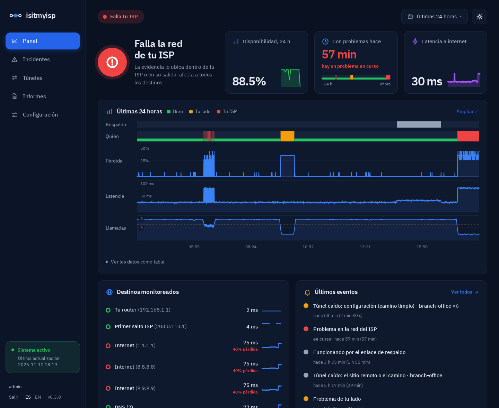
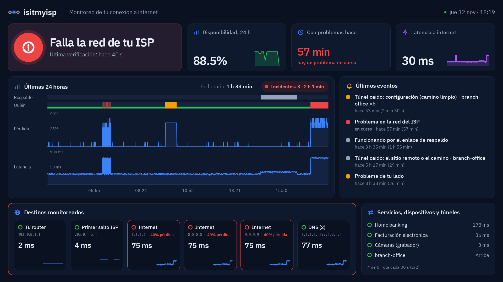
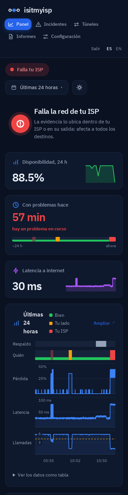
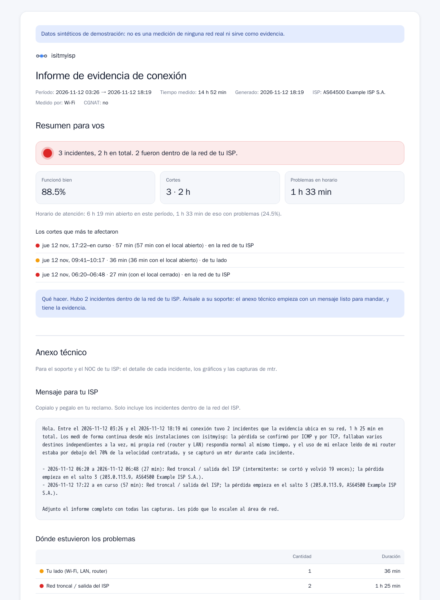

<p align="center">
  <picture>
    <source media="(prefers-color-scheme: dark)" srcset="docs/brand/logo-dark.svg">
    
  </picture>
</p>

<h3 align="center">¿Es tu Wi-Fi, tu router o tu ISP?</h3>

<p align="center">
  Un monitor de la conexión para casas, oficinas y comercios, hecho por alguien que trabajó en el NOC de un ISP.<br>
  Te dice <b>de quién es la culpa</b> de un corte, en una frase, y arma la evidencia que tu proveedor necesita para escalar el reclamo.
</p>

<p align="center">
  <a href="https://github.com/21Enzo17/isitmyisp/releases"></a>
  <a href="https://hub.docker.com/r/21enzo03/isitmyisp"></a>
  <a href="LICENSE"></a>
  
  
</p>

<p align="center">
  <a href="https://isitmyisp.enzo-meneghini.com/es/isp/"><b>Demo en vivo</b></a> ·
  <a href="https://isitmyisp.enzo-meneghini.com/docs/es/"><b>Documentación</b></a> ·
  <a href="#instalarlo-con-un-comando">Instalar</a> ·
  <a href="README.md">In English</a>
</p>



## Para qué sirve

Cuando se corta internet, todos le echan la culpa a alguien: el ISP dice "reiniciá el módem", el técnico dice "es el ISP", y un gráfico de ping no lo resuelve. isitmyisp mide desde tu lado todo el día y responde la pregunta directamente:

- **Un veredicto, no un gráfico.** "Falla la red de tu ISP", "el problema está de tu lado (Wi-Fi o router)", "solo está caído tu banco", "tu DNS". Separa la pérdida real del ruido de ICMP (saltos intermedios que "pierden" pings mientras el tráfico pasa bien), exige que ICMP y TCP coincidan, y solo cuenta la pérdida que es estadísticamente significativa.
- **Detecta lo que en un reclamo se pierde.** Cortes continuos, y enlaces que **se cortan y vuelven** cada uno o dos minutos (marcados como *intermitentes*, con la cantidad de cortes). El paso al enlace de respaldo. Y, con el router conectado por SNMP, si fuiste *vos* quien llenó el enlace, la objeción favorita del ISP.
- **Evidencia que el ISP no puede ignorar.** Un informe con un resumen en palabras simples para vos y un anexo técnico para su NOC: un mensaje listo para pegar con solo los incidentes dentro de su red, el salto y el AS donde empieza la pérdida, cada captura de mtr, y qué descarta la evidencia y qué no.
- **Pensado para un comercio.** Un tablero para la tele de la pared, el posnet y la impresora fiscal también chequeados ("¿se cayó el posnet o internet?"), tu horario de atención, alertas por Telegram, email o webhook, y el informe del mes en tu correo, solo.

Todo corre en un equipo chico en tu red (alcanza con una Raspberry Pi). Sin nube, sin cuenta, sin telemetría.

## Probalo en un minuto

**Online:** la [demo en vivo](https://isitmyisp.enzo-meneghini.com/es/isp/). Pasá entre "falla tu ISP", "en el enlace de respaldo", "problema de tu lado" y "todo bien" desde la franja de arriba, y abrí el [modo TV](https://isitmyisp.enzo-meneghini.com/es/isp/tv/) o el [informe](https://isitmyisp.enzo-meneghini.com/es/isp/report/). Son datos de ejemplo, y lo dice en cada página.

**En tu equipo,** la misma demo, en vivo y de solo lectura (no mide ni guarda nada):
```bash
docker run --rm -p 127.0.0.1:8090:8080 21enzo03/isitmyisp --lang es demo --scenario isp --bind 0.0.0.0:8080
```
Después abrí **http://127.0.0.1:8090**. Escenarios: `healthy`, `isp`, `failover`, `wifi`.

## Instalarlo con un comando

En un equipo con Linux que quede prendido (una Raspberry Pi, una mini PC, un servidor), conectado por cable al router:
```bash
curl -fsSL https://isitmyisp.enzo-meneghini.com/install.sh | sh
```
El [instalador](install.sh) es corto y muestra cada comando antes de ejecutarlo. Instala Docker si falta, arranca la imagen publicada (amd64 o arm64) y te muestra el link para crear la cuenta de administrador; un asistente hace el resto. Para actualizar, volvé a correrlo: los datos se conservan. Las opciones y el `docker run` a mano están en la [guía de instalación](https://isitmyisp.enzo-meneghini.com/docs/es/install/), y la [guía de Raspberry Pi](https://isitmyisp.enzo-meneghini.com/docs/es/raspberry-pi/) va de grabar la tarjeta a la página de configuración en unos 15 minutos.

> Necesita Linux: en Docker Desktop (Mac o Windows) el contenedor no ve tu red real.

## En qué se diferencia

| | Qué te dice |
|---|---|
| **Uptime Kuma** | Si un sitio o servicio responde. No si la culpa es de tu red, de tu ISP o del servicio. |
| **SmokePing, PingPlotter** | Gráficos de latencia y pérdida por destino. Leerlos, y separar el ruido de ICMP de la pérdida real, queda a tu cargo. |
| **isitmyisp** | De quién es la culpa, en una frase, con la evidencia que lo respalda y un informe para el ISP. |

Se complementan bien: Uptime Kuma para tus servicios, isitmyisp para la conexión de la que dependen.

## Qué tiene

<p>
  
  
</p>

- **Panel:** el veredicto al lado de la disponibilidad, el tiempo sin cortes y la latencia; las últimas 24 horas (de quién fue la culpa, pérdida, latencia, calidad de llamadas, enlace de respaldo) con valores al pasar el mouse y una vista en tabla; cada destino; los últimos eventos; en qué tramo está el problema y qué hacer. Modo claro y oscuro. Todo funciona sin JavaScript.
- **Modo TV:** abrí `/tv` en la tele, escribí en Configuración el código corto que muestra, y queda vinculada. Un tablero que se acomoda a cualquier pantalla de 720p a 4K, o una vista simple para el mostrador.
- **Tus servicios y dispositivos:** tu banco, tu sistema de gestión o ARCA (con presets de un clic para Argentina), y los aparatos de tu red (posnet, impresoras, cámaras, centrales telefónicas), para que "¿es mi internet o son ellos?" tenga respuesta.
- **Respaldo, llamadas y velocidad:** detecta en un minuto cuando el tráfico pasa al enlace de respaldo; estima la calidad de las llamadas (modelo E de la ITU-T G.107, aclarando que es una estimación); un test de velocidad opcional contra tu plan, apagado por defecto, con presupuesto de datos.
- **Túneles:** ¿se cayó tu túnel IPsec/L2TP/WireGuard por su configuración o por el camino? Mide afuera y adentro a la vez, y detecta los cortes que se repiten con horario fijo (timers de rekey distintos).
- **Alertas e informes:** Telegram, email o webhook, solo para problemas que duran, diciendo de quién es la culpa y qué hacer; retenidas con el local cerrado si querés, con un resumen al abrir. El informe de evidencia en HTML o PDF, cuando lo pidas o por mail cada mes.
- **Varios usuarios y seguro en tu red:** administradores y lectores, contraseñas con Argon2id, protección CSRF, una CSP estricta (sin código inline; el único script es el zoom arrastrando del gráfico, opcional), o inicio de sesión único con Authelia, Authentik, oauth2-proxy o Tailscale. `/metrics` para Prometheus y una API JSON.



## Cómo decide

Cada 30 segundos mide tu router, el primer salto de tu ISP, tres destinos de internet independientes (ICMP y una conexión TCP al puerto 443) y tu DNS:

1. **Tu lado:** falla tu router *y* falla internet a través de él. Un router que solo "pierde" pings mientras internet anda está filtrando ICMP, y no se culpa a nadie.
2. **Tu ISP:** fallan todos los destinos de internet a la vez. Si su primer salto también falla, es la red de acceso; si no, su backbone o su proveedor.
3. **No es tu ISP:** fallan solo algunos destinos, o solo uno de tus servicios, o solo el DNS.

La pérdida tiene que ser estadísticamente significativa (intervalo de Wilson al 95 %, con al menos 2 paquetes perdidos); la latencia se juzga contra lo normal de cada destino. Un problema continuo pasa a ser incidente con dos ventanas malas seguidas; un enlace que se corta una y otra vez (tres ventanas malas en cinco minutos) pasa a ser un incidente *intermitente*. Cada incidente del lado del ISP guarda qué descarta la evidencia (tu red, el ruido de ICMP, un único sitio caído, un enlace lleno) y qué no. Detalles: [cómo decide el veredicto](https://isitmyisp.enzo-meneghini.com/docs/es/verdict/).

## Privacidad

isitmyisp está pensado para correr meses en tu red, y por defecto **nunca manda tus datos ni las IP de tu camino a terceros**. Hace ping a tu router, al primer salto de tu ISP y a 1.1.1.1, 8.8.8.8 y 9.9.9.9, abre conexiones TCP a esos mismos tres, consulta a tus propios servidores DNS, y corre `mtr` cuando hay un incidente: alrededor de 1,3 GB por mes. Todo lo demás (búsqueda de AS, tu IP pública, el test de velocidad, tus servicios, las alertas) está apagado hasta que lo actives. [Cada conexión, listada](https://isitmyisp.enzo-meneghini.com/docs/es/privacy/).

## Estado y próximos pasos

La versión 0.2 es la primera publicada ([cambios](CHANGELOG.md)). Corre todos los días en las redes del autor, pero todavía no se probó en muchas otras: si el veredicto se equivoca con la tuya, una [issue](https://github.com/21Enzo17/isitmyisp/issues) con una captura del panel y la salida de `isitmyisp discover` ayuda mucho. Las capturas usan datos de ejemplo.

Lo próximo, en las [issues](https://github.com/21Enzo17/isitmyisp/issues): cuánto le cuesta un corte a un comercio, alertas por WhatsApp, un panel central para varias sedes, distinguir un corte de luz de uno de internet, la calidad del Wi-Fi alrededor de la sonda, y qué equipos llenan el enlace.

La línea de comandos, el desarrollo y los detalles técnicos están en el [README en inglés](README.md) y en la [documentación](https://isitmyisp.enzo-meneghini.com/docs/es/).

## Licencia

MIT
