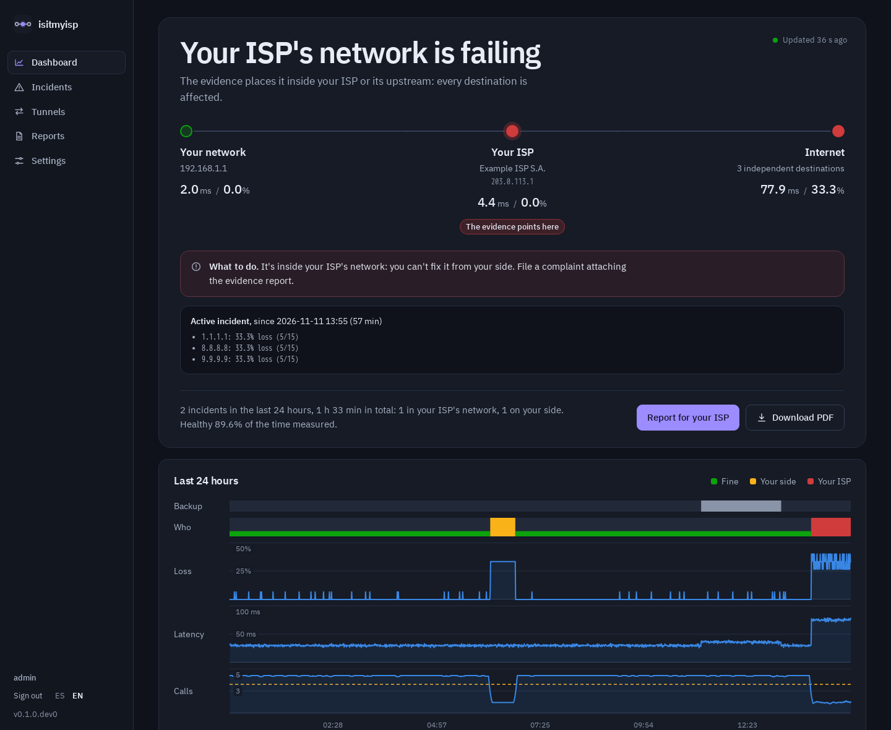
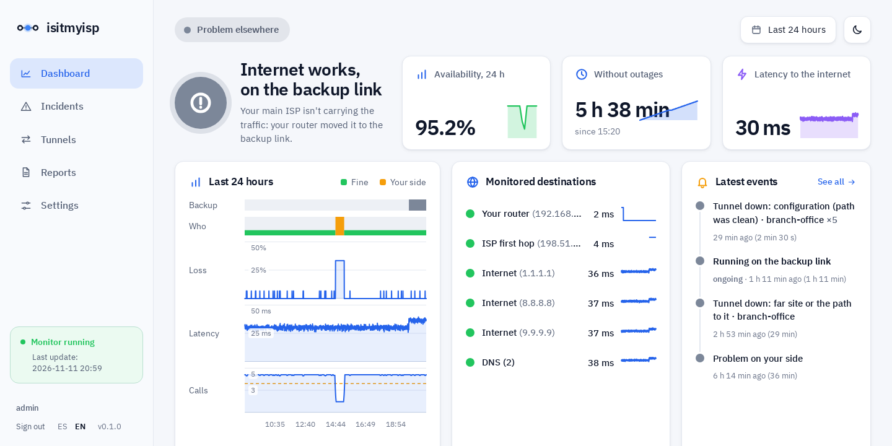
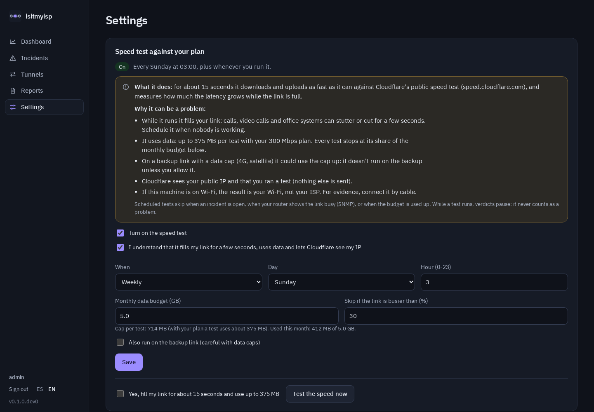
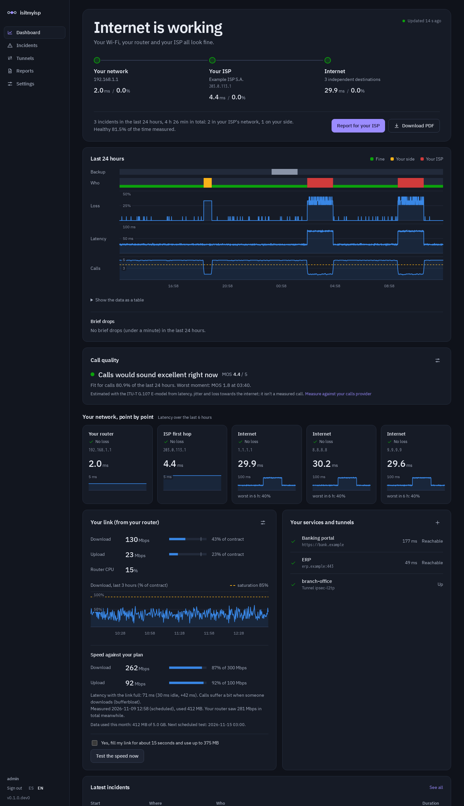
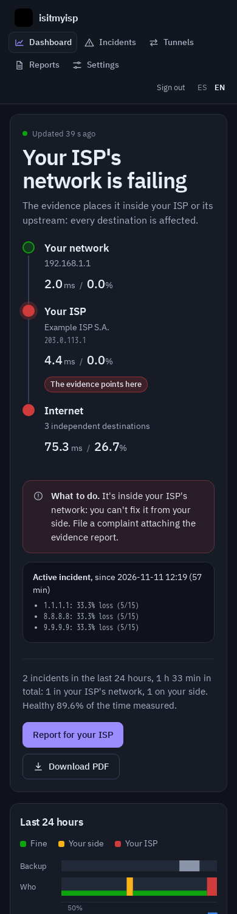
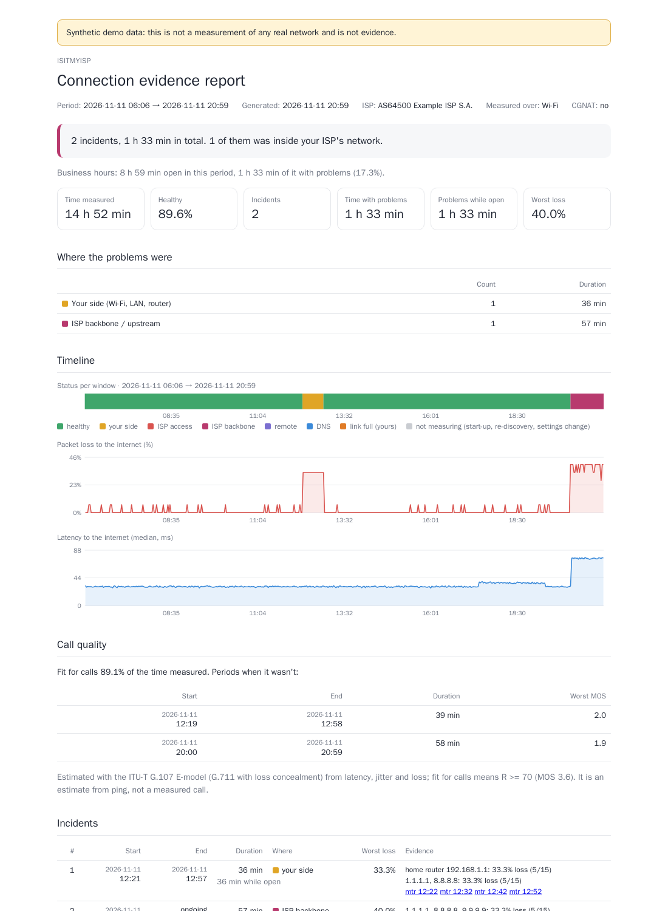

<p align="center">
  <picture>
    <source media="(prefers-color-scheme: dark)" srcset="docs/brand/logo-dark.svg">
    
  </picture>
</p>

<h3 align="center">Is it your Wi-Fi, your router or your ISP?</h3>

<p align="center">
  A self-hosted connection monitor for homes and small offices, built by someone who worked in an ISP's NOC.<br>
  It finds <b>where</b> a problem is, says it in plain words, and builds the evidence your ISP needs to escalate the ticket.
</p>

<p align="center">
  <a href="LICENSE"></a>
  
  
  
  
  
  
</p>

<p align="center">
  <a href="https://isitmyisp.enzo-meneghini.com"><b>Live demo</b></a> ·
  <a href="https://isitmyisp.enzo-meneghini.com/docs/en/"><b>Docs</b></a> ([español](https://isitmyisp.enzo-meneghini.com/docs/es/)) ·
  <a href="#try-it-in-a-minute">Run the demo</a> ·
  <a href="#quick-start-docker-recommended">Quick start</a> ·
  <a href="#what-it-answers">What it answers</a> ·
  <a href="#privacy-every-external-connection-listed">Privacy</a> ·
  <a href="#the-evidence-report">Evidence report</a> ·
  <a href="#roadmap">Roadmap</a>
</p>



> 🚧 Early development: monitoring, incidents, the evidence report (HTML/PDF), the dashboard, alerts, failover, call quality and the speed test all work. Not yet battle-tested on many networks. Screenshots use synthetic data.

## Try it in a minute
**Online:** [isitmyisp.enzo-meneghini.com](https://isitmyisp.enzo-meneghini.com) (Spanish; [English](https://isitmyisp.enzo-meneghini.com/en/isp/)). Switch between "your ISP is failing", "on the backup link", "problem on your side" and "all fine" from the banner. It's synthetic data, regenerated on every deploy.

**On your machine:** the whole UI on a synthetic day, live and read-only: no network access, no root, nothing measured, nothing stored.
```bash
docker build -t isitmyisp .
docker run --rm -p 127.0.0.1:8090:8080 isitmyisp --lang en demo --scenario isp --bind 0.0.0.0:8080
```
Open **http://127.0.0.1:8090**. `--scenario` picks what the network is doing right now: `healthy`, `isp` (an incident in the ISP's network), `failover` (running on the backup link) or `wifi` (the problem is on your side). Every page says it's demo data, and reports generated from it are marked as synthetic on every page. Without Docker: `pip install -e '.[web]' && isitmyisp demo`.

The UI has no JavaScript, so the demo also works as a plain static site: `isitmyisp demo --static site` renders every page of every scenario in Spanish and English (about 10 seconds) with a scenario switcher and the same strict CSP in a Netlify `_headers` file. `netlify.toml` builds it on every deploy.

## Who it's for
- **Homes** that are tired of "restart the modem" and want proof.
- **Small offices and shops** where the internet *is* the till, the phones and the invoicing: one small box (a Raspberry Pi is enough) tells you whose fault an outage was and gives you the report to claim.
- **IT providers** who look after those offices: a verdict you can show the client, failover and call quality at a glance, and an evidence report the ISP can't wave away.

## What it answers

**Whose fault is it?**
- **The path, not a ping graph.** Your network → your ISP → the internet, with the segment the evidence points to marked, using address types and AS numbers rather than hop positions (your router, a second router behind it, the ISP's access network, its backbone, or a single remote destination).
- **Real loss vs ICMP noise.** Routers deprioritize replies to themselves, so `mtr` shows "loss" on a middle hop while traffic through it is fine. Only loss that persists to the destination counts, and ICMP and TCP (handshakes to port 443) must agree.
- **It doesn't cry wolf.** "1 packet lost out of 50" is noise, not 2 % loss: loss must be statistically significant (95 % Wilson interval), latency is judged against each target's own baseline, and incidents need consecutive bad windows.
- **It doesn't over-claim.** Every ISP-side incident lists **what the evidence rules out** (your LAN, ICMP noise, a single website, a full link) and **what it can't**. Connected to your router (SNMP, read-only), it rules out the ISP's favourite objection, "you saturated your own link", or tells you that you did.
- **Your services:** "is it my internet, or is my bank / my ERP / the tax agency down?" Any HTTP(S) or TCP service; when it fails while your connection is healthy, the verdict says so. For Argentina there are one-click presets (ARCA's Clave Fiscal, e-invoicing and WSAA, Rentas Jujuy, the main banks, Mercado Pago, Payway, Google Workspace, Microsoft 365, WhatsApp Web, Zoom), each saying exactly what it checks; they live in an editable JSON file (`isitmyisp/presets/services_ar.json`) and `ISITMYISP_NETWORK_TESTS=1 python -m unittest tests.test_presets` verifies every one still answers.

**Is the office running as it should?**
- **Failover:** with a dual-WAN router, it notices within about a minute when the traffic moves to the backup link and when it comes back, and the report says from when to when the main ISP wasn't carrying it.

  
- **Call quality:** would a call sound good right now? An estimated MOS (ITU-T G.107 E-model) from the latency, jitter and loss it already measures, against your SIP provider if you set one. It says plainly that it's an estimate, not a measured call.
- **Speed against your plan, off by default:** it fills your link for a few seconds and uses data, so it ships disabled, explains why, and asks you to accept the risks first. Monthly data budget, never on the backup link, never during an incident; it also measures the latency with the link full (bufferbloat) and warns when the result is your Wi-Fi rather than your ISP.

  
- **Tunnels:** did your IPsec/L2TP/WireGuard tunnel drop because of its configuration or because of the path? It measures outside and inside the tunnel at once, and spots drops that repeat on a schedule (mismatched rekey lifetimes).

**What do I send my ISP, and who tells me?**
- **The evidence report** (HTML/PDF): a plain-language summary for you, a ready-to-paste message for the ISP's NOC with only the incidents inside their network, every mtr capture, call quality and measured speed.
- **Alerts** by Telegram, email or webhook (Discord, Slack, Home Assistant…), only for problems that last, each one saying whose fault it is and what to do.
- **The monthly report by email:** on the day you choose, last month's report arrives on its own, with a plain-language summary and the full report attached, ready to forward.

<p>
  
  
</p>

```
$ isitmyisp discover
   1. [home]   192.168.1.1        0.0%     1.6 ms  ok
   2. [ISP]    203.0.113.1        0.0%     4.2 ms  ok  AS64500 Example ISP
   3. [ISP]    203.0.113.65       0.0%    29.6 ms  ok  AS64500 Example ISP
   4. [ISP]    ???              100.0%     0.0 ms  no reply
   5. [ISP]    198.51.100.39     40.0%    28.9 ms  ignored (ICMP deprioritized)  AS64500 Example ISP
   6. [ISP]    198.51.100.246     0.0%    34.1 ms  ok  AS64500 Example ISP
   7. [beyond] 1.1.1.1            0.0%    29.2 ms  ok  AS13335 Cloudflare, Inc.

  Destination reached with 0.0% loss: the path is fine. Loss on intermediate hops is ICMP handling, not real loss.
```

## Install (one line)
On a Linux machine that stays on (a Raspberry Pi, a mini PC, a server), wired to the router:
```bash
curl -fsSL https://isitmyisp.enzo-meneghini.com/install.sh | sh
```
The [installer](install.sh) is short and shows every command before running it. It installs Docker if it's missing, starts the monitor with the flags below and prints the link to create the admin account; a first-run wizard does the rest. Run it again to update (data is kept). Options: `--local` (dashboard on this machine only), `--port`, `--lang`, `--tz`, `--version`, `--uninstall`, `--dry-run`.

New Raspberry Pi? Follow the [Raspberry Pi guide](https://isitmyisp.enzo-meneghini.com/docs/en/raspberry-pi/) ([español](https://isitmyisp.enzo-meneghini.com/docs/es/raspberry-pi/)): about 15 minutes from flashing the card to the setup page. Releases are listed in the [changelog](CHANGELOG.md).

## Manual install (Docker)
```bash
docker build -t isitmyisp .
docker run --rm --net=host --cap-add=NET_RAW -v isitmyisp:/data isitmyisp update-asn   # once, optional
docker run --rm --net=host --cap-add=NET_RAW -v isitmyisp:/data \
  -v /run/systemd/resolve:/run/systemd/resolve:ro isitmyisp status

# keep it running, then build the report for your ISP
docker run -d --name isitmyisp --restart unless-stopped --net=host --cap-add=NET_RAW \
  -e TZ=America/Argentina/Buenos_Aires -v isitmyisp:/data \
  -v /run/systemd/resolve:/run/systemd/resolve:ro isitmyisp monitor
docker exec isitmyisp isitmyisp report --since 7d -o /data/report.html
```
Set `TZ` to your time zone so the report shows local times. While `monitor` runs, the web UI is on **http://127.0.0.1:8080** (local only by default; `--web 0.0.0.0:8080` exposes it on your LAN, `--web off` disables it). On first start the logs print a **one-time setup token**: open the link, create your admin account, and configure everything from the browser.

The image is ~330 MB, mostly because of the PDF engine (WeasyPrint + Pango).
`--net=host` is required to see your real gateway and path. The `/run/systemd/resolve` mount is optional: it lets the container see your real DNS servers on systemd-resolved hosts. Without it, your router is assumed to be your resolver.

## Without Docker
Needs Linux, `fping` (recommended) or iputils `ping`, and `mtr`. No root. The measuring core has no Python dependencies; the web UI and PDF are extras.
```bash
pip install -e .            # CLI only
pip install -e '.[web,pdf]' # + web UI and PDF
isitmyisp discover          # gateway, ISP, DNS, CGNAT, IPv6, path segments
isitmyisp status -s 30      # measure 30 s and get a verdict
isitmyisp mtr 8.8.8.8       # mtr with real loss vs ICMP noise
isitmyisp monitor           # measure continuously, open/close incidents, capture mtr evidence
isitmyisp report --since 7d # self-contained HTML evidence report
isitmyisp report --pdf      # PDF (pip install 'isitmyisp[pdf]')
isitmyisp web               # dashboard + /metrics from an existing database
isitmyisp demo --scenario isp  # the UI on synthetic data, live and read-only
isitmyisp --lang es status  # Spanish output
```

## Privacy: every external connection, listed
isitmyisp is meant to run on your network for months. By default it **never sends your data or your path's IPs to any third party.**

| Connection | When | What it sends | Default |
|---|---|---|---|
| ICMP to your gateway, your ISP's first hop, 1.1.1.1, 8.8.8.8, 9.9.9.9 | always | ICMP echo (64 bytes) | on |
| One TTL-limited ping towards 1.1.1.1 | once per window | ICMP echo that expires at your ISP's first router (failover check) | on |
| TCP handshake to 1.1.1.1, 8.8.8.8, 9.9.9.9 port 443 | always | SYN, then closes (no data, no TLS) | on |
| DNS queries to your own resolvers | always | A queries for www.google.com, www.cloudflare.com, www.wikipedia.org | on |
| `mtr` to 1.1.1.1 | on discovery and incidents | ICMP probes | on |
| iptoasn.com | only when you run `update-asn` or press the button in Settings | one HTTPS download of the public dataset (no per-IP queries) | manual |
| Team Cymru whois | only with `--asn-online` | the public IPs of your path | **off** |
| api.ipify.org | only with `--public-ip` | an HTTPS request (reveals your public IP to them) | **off** |
| Your services | only the ones you add | an HTTP GET (or TCP connect) every 30 s | **off** |
| speed.cloudflare.com (speed test) | only if you turn it on and accept the risks: weekly by default, or when you press "test now" | downloads and uploads for ~15 s (up to its share of a monthly data budget); Cloudflare sees your public IP | **off** |
| Your router (SNMP v2c, read-only) | only if you connect it | GET of the WAN interface counters and CPU, once per window | **off** |
| api.telegram.org / your SMTP server / your webhook | only if you enable alerts | the alert text | **off** |

Bandwidth: about 1.3 GB/month at the default `monitor` settings (one ping every 2 s to 5–6 targets).

## Web UI and security
Dashboard, incidents, tunnels, reports and **settings** (anchors, intervals, language, tunnels, access) are all in the browser and applied live: no restart, no config files to edit. Everything works without JavaScript.

Authentication is built on audited libraries, not hand-rolled crypto:

| | |
|---|---|
| **Accounts** | Flask-Login sessions, **Argon2id** password hashes (argon2-cffi), login rate limit (Flask-Limiter) |
| **First admin** | Created with a one-time setup token printed in the logs, so nobody on your LAN can claim the instance first |
| **CSRF** | Token on every form (Flask-WTF) plus a same-origin `Origin` check |
| **Headers** | Strict CSP (no scripts at all), `X-Frame-Options: DENY`, `HttpOnly` + `SameSite` cookies (`ISITMYISP_SECURE_COOKIES=1` behind HTTPS) |
| **Server** | Waitress (production WSGI), untrusted `X-Forwarded-*` headers stripped |

Three authentication modes, chosen in Settings → Access:
- **local** (default): accounts with passwords, each one an **admin** (changes settings, users and alerts) or a **viewer** (sees the dashboard, incidents and reports, changes nothing but their own password). Admins invite people and reset passwords with one-time links that expire in 48 hours, and can disable an account, which ends its open sessions at once. The role is enforced for every request, not route by route.
- **TV mode:** a read-only wall screen for the office (large type, refreshes by itself, no menus, no login) behind a revocable link from Settings.
- **proxy**: trust a user header (`Remote-User`) from **Authelia, Authentik, oauth2-proxy or Tailscale**, only from the proxy addresses you list. You get SSO, 2FA and passkeys from your proxy. The UI refuses to switch to this mode unless your current request really comes through the proxy, so you can't lock yourself out.
- **none**: only allowed while the UI listens on localhost, and settings become read-only.

Locked out anyway? Recover from the console:
```bash
docker exec -it isitmyisp isitmyisp admin auth-mode local
docker exec -it isitmyisp isitmyisp admin reset-password <user>
docker exec -it isitmyisp isitmyisp admin setup-token
```
Prometheus scrapes `/metrics` with a bearer token shown in Settings (`authorization: { credentials: <token> }`). `/healthz` is public and only returns `{"ok": true|false}`.

## Dashboard, metrics and API
| Path | What |
|---|---|
| `/` | Status pill, the verdict beside three figures (availability, time without outages, latency) with 24 h sparklines and change vs the day before; last 24 h (who, loss, latency, calls, backup link) with hover readouts and a table view; monitored destinations with 6 h of history; latest events; where the problem is (the path, what to do, what the evidence rules out); your link and speed, calls, services and tunnels. Refreshes every 30 s; no JavaScript (hover is pure CSS); light and dark with a theme button |
| `/report?since=7d&lang=es` | Evidence report (HTML) |
| `/report.pdf?since=7d` | Evidence report (PDF) |
| `/metrics` | Prometheus: `isitmyisp_loss_ratio`, `isitmyisp_rtt_median_ms`, `isitmyisp_verdict`, `isitmyisp_incident_active`, `isitmyisp_incidents_total` |
| `/api/status` | Current state as JSON (login or proxy auth) |
| `/healthz` | Public liveness check, no details |

## Tunnel mode
Add tunnels in **Settings → Tunnels**. If you prefer configuration as code, a `config.toml` in the data directory (`/data` in Docker) or `--config` takes precedence, and the UI shows those tunnels read-only:
```toml
[[tunnel]]
name = "branch-office"
underlay = "203.0.113.10"   # the far end's PUBLIC address (outside the tunnel)
overlay = "10.10.0.1"       # an address on the far side reached THROUGH the tunnel
type = "ipsec-l2tp"         # ipsec-l2tp | ipsec | wireguard | openvpn | other
```
| Through the tunnel | Outside the tunnel | Verdict |
|---|---|---|
| fine | — | up |
| failing | clean | **tunnel configuration**: DPD, IKE/IPsec lifetimes and rekey, NAT-T, MTU/MSS |
| failing | losing too, your internet fine | **the far site or the path to it** |
| failing | losing too, your internet bad | **your connection** |
| failing | the far end never answers ping | can't tell (it filters ICMP) |

If configuration drops repeat at a regular interval, the report says so: that's almost always mismatched lifetimes or rekey timers between both ends.

## The evidence report
`isitmyisp report` writes one self-contained HTML file: no JavaScript and no external assets. It has two readers in mind:



- **You:** a plain-language summary ("3 incidents, 1 h 6 min in total; 2 were inside your ISP's network"), a timeline and where each problem was.
- **Your ISP's support and NOC:** a ready-to-paste message listing only the incidents inside their network, with the hop and AS where loss starts, plus every mtr capture and the methodology.

To try it without waiting for real problems, `isitmyisp demo` serves it on a synthetic day (the report link works there), or generate a database with `python3 scripts/demo_data.py /tmp/demo.db && isitmyisp report --db /tmp/demo.db --since 1d`. Reports built from demo data say so on every page.

## Retention
Per-target samples are kept 35 days (enough for a monthly report); window verdicts, incidents and their mtr evidence about 13 months. Old data is deleted automatically every hour.

## How the verdict works
1. **Home:** loss or abnormal latency to your own router(s) **that also shows up on the internet** means the problem is on your side. If only the router "loses" pings while the internet works through it, the router just filters ICMP (common on business firewalls) and nobody is blamed.
2. **Every destination affected:** the problem is in your ISP. If its first hop is also affected, it's the access network; otherwise it's the backbone or its upstream.
3. **Only some destinations:** it's not your ISP.
4. **Everything fine except DNS:** your resolver.

ICMP and TCP must agree before blaming anyone, and nothing is blamed on a handful of lost packets.

## Roadmap
Planned work lives in the [issues](https://github.com/21Enzo17/isitmyisp/issues), grouped in two milestones:
- [**v0.2 Ready to sell**](https://github.com/21Enzo17/isitmyisp/milestone/1): demo mode, first-run wizard, business hours and the cost of downtime, monthly report by email, roles and a TV mode, WhatsApp alerts, local devices (card terminals, printers, cameras), easy install.
- [**v0.3 Managed service**](https://github.com/21Enzo17/isitmyisp/milestone/2): multi-site hub, multi-client console with white-label reports, assisted ISP claims, top talkers, power vs internet outages, Wi-Fi quality, out-of-band alerts.

Already done: probes and discovery (fping/ping, TCP, DNS, CGNAT, double NAT, IPv6, offline ASN), statistical verdicts with baselines and hysteresis, incidents with mtr evidence, the evidence report (EN/ES, HTML/PDF), tunnel mode, the web UI with live settings and local/proxy auth, Prometheus metrics, alerts, your own services, SNMP link usage, "what the evidence rules out", failover detection, call quality and the speed test.

## Development
```bash
pip install -e '.[web,pdf]'
pip install markdown && python3 scripts/build_docs.py site   # the docs site (docs/site/*.md) into site/docs
python -m unittest discover -s tests       # also runs without the extras (web tests are skipped)
python3 scripts/screenshots.py             # regenerate docs/screenshots from synthetic data (needs Docker)
```
Work happens in branches (`feat/…`, `fix/…`, `docs/…`) with a pull request that closes its issue.

## License
MIT
