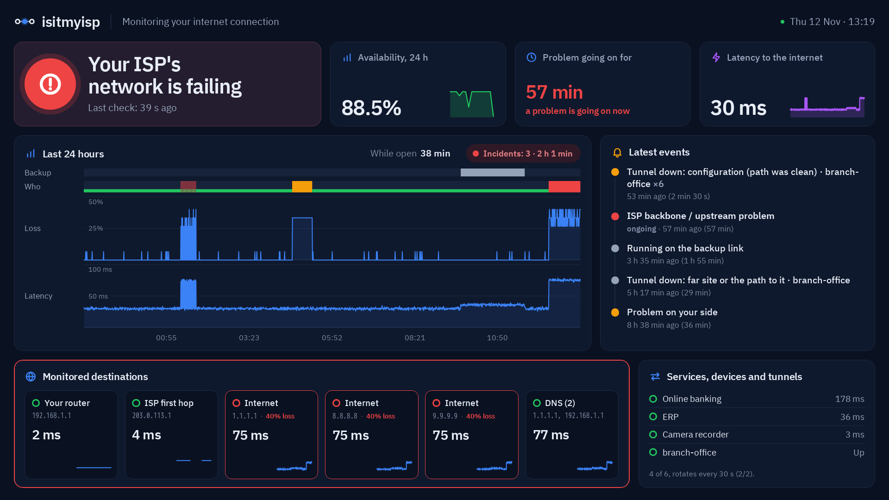

<p align="center">
  <picture>
    <source media="(prefers-color-scheme: dark)" srcset="docs/brand/logo-dark.svg">
    
  </picture>
</p>

<h3 align="center">Is it your Wi-Fi, your router or your ISP?</h3>

<p align="center">
  A self-hosted connection monitor for homes and small offices, built by someone who worked in an ISP's NOC.<br>
  It tells you <b>whose fault</b> an outage is, in one sentence, and builds the evidence your ISP needs to escalate the ticket.
</p>

<p align="center">
  <a href="https://github.com/21Enzo17/isitmyisp/releases"></a>
  <a href="https://hub.docker.com/r/21enzo03/isitmyisp"></a>
  <a href="LICENSE"></a>
  
  
  
</p>

<p align="center">
  <a href="https://isitmyisp.enzo-meneghini.com/en/isp/"><b>Live demo</b></a> ·
  <a href="https://isitmyisp.enzo-meneghini.com/docs/en/"><b>Docs</b></a> ·
  <a href="#install-one-line">Install</a> ·
  <a href="README.es.md">En español</a>
</p>


## Why

When the internet fails, everybody blames somebody: the ISP says "restart the modem", the IT person says "it's the ISP", and a ping graph doesn't settle it. isitmyisp measures from your side all day and answers the question directly:

- **A verdict, not a graph.** "Your ISP's network is failing", "the problem is on your side (Wi-Fi or router)", "only your bank is down", "your DNS". It separates real loss from ICMP noise (middle hops that "lose" pings while traffic through them is fine), requires ICMP and TCP to agree, and only counts loss that is statistically significant.
- **It catches what support tickets get lost in.** Steady outages, and links that **drop and come back** every minute or two (marked *intermittent*, with the number of drops). Moving to the backup link. And, with your router connected over SNMP, whether *you* filled your own link, the ISP's favourite objection.
- **Evidence the ISP can't wave away.** A report with a plain-language summary for you and a technical annex for their NOC: a ready-to-paste message with only the incidents inside their network, the hop and AS where loss starts, every mtr capture, and what the evidence rules out and what it can't.
- **Made for a small business.** A TV board for the wall, your card terminal and fiscal printer checked too ("did the terminal drop, or the internet?"), your opening hours, alerts by Telegram, email or webhook, and last month's report in your inbox on its own.

Everything runs on one small box on your network (a Raspberry Pi is enough). No cloud, no account, no telemetry.

## Try it in a minute

**Online:** the [live demo](https://isitmyisp.enzo-meneghini.com/en/isp/) ([español](https://isitmyisp.enzo-meneghini.com/es/isp/)). Switch between "your ISP is failing", "on the backup link", "problem on your side" and "all fine" from the banner, and open the [TV board](https://isitmyisp.enzo-meneghini.com/en/isp/tv/) or the [report](https://isitmyisp.enzo-meneghini.com/en/isp/report/). It's synthetic data, and says so on every page.

**On your machine,** the same demo, live and read-only (it measures nothing and stores nothing):
```bash
docker run --rm -p 127.0.0.1:8090:8080 21enzo03/isitmyisp --lang en demo --scenario isp --bind 0.0.0.0:8080
```
Then open **http://127.0.0.1:8090**. Scenarios: `healthy`, `isp`, `failover`, `wifi`.

## Install (one line)

On a Linux machine that stays on (a Raspberry Pi, a mini PC, a server), wired to the router:
```bash
curl -fsSL https://isitmyisp.enzo-meneghini.com/install.sh | sh
```
The [installer](install.sh) is short and shows every command before running it. It installs Docker if it's missing, starts the published image (amd64 or arm64) and prints the link to create the admin account; a first-run wizard does the rest. Run it again to update; your data is kept. Options and the manual `docker run` are in the [install guide](https://isitmyisp.enzo-meneghini.com/docs/en/install/), and the [Raspberry Pi guide](https://isitmyisp.enzo-meneghini.com/docs/en/raspberry-pi/) goes from flashing the card to the setup page in about 15 minutes.

> It needs Linux: on Docker Desktop (Mac or Windows) the container can't see your real network.

## How it compares

| | What it tells you |
|---|---|
| **Uptime Kuma** | Whether a site or service answers. Not whether the fault is your network, your ISP or the service. |
| **SmokePing, PingPlotter** | Latency and loss graphs per destination. Reading them, and telling ICMP noise from real loss, is up to you. |
| **isitmyisp** | Whose fault it is, in one sentence, with the evidence to back it and a report for the ISP. |

They work well together: Uptime Kuma for your services, isitmyisp for the connection they depend on.

## What you get

<p>
  
  
</p>

- **Dashboard:** the verdict beside availability, time without outages and latency; the last 24 hours (who was at fault, loss, latency, call quality, backup link) with hover readouts and a table view; every destination; latest events; where on the path the problem is and what to do. Light and dark. Everything works without JavaScript.
- **TV mode:** open `/tv` on the TV, type the short code it shows in Settings, and it stays paired. A board that fits any screen from 720p to 4K, or a simple view for a shop counter.
- **Your services and devices:** your bank, your ERP or the tax agency (with one-click presets for Argentina), and devices on your network (card terminals, printers, cameras, phone systems), so "is it my internet or is it them?" has an answer.
- **Failover, calls and speed:** notices within about a minute when traffic moves to the backup link; an estimated call quality (ITU-T G.107 E-model, labelled as an estimate); an optional speed test against your plan, off by default, with a data budget.
- **Tunnels:** did your IPsec/L2TP/WireGuard tunnel drop because of its configuration or because of the path? It measures outside and inside at once, and spots drops that repeat on a schedule (mismatched rekey timers).
- **Alerts and reports:** Telegram, email or webhook, only for problems that last, each saying whose fault it is and what to do; held while you're closed if you want, with one summary at opening time. The evidence report in HTML or PDF, on demand or monthly by email.
- **Multi-user and safe on your LAN:** admins and viewers, Argon2id passwords, CSRF protection, a strict CSP with no scripts at all, or single sign-on through Authelia, Authentik, oauth2-proxy or Tailscale. Prometheus `/metrics` and a JSON API.


## How the verdict works

Every 30 seconds it measures your router, your ISP's first hop, three independent internet destinations (ICMP and a TCP handshake to port 443) and your DNS:

1. **Your side:** your router fails *and* the internet fails through it. A router that only "loses" pings while the internet works is just filtering ICMP, and nobody is blamed.
2. **Your ISP:** every internet destination fails at once. If its first hop fails too, it's the access network; otherwise its backbone or upstream.
3. **Not your ISP:** only some destinations fail, or only one of your services, or only DNS.

Loss must be statistically significant (95 % Wilson interval, at least 2 lost packets); latency is judged against each destination's own baseline. A steady problem becomes an incident after two bad windows in a row; a link that keeps dropping (three bad windows within five minutes) becomes an *intermittent* incident. Every ISP-side incident records what the evidence rules out (your LAN, ICMP noise, a single website, a full link) and what it can't. Details: [how the verdict works](https://isitmyisp.enzo-meneghini.com/docs/en/verdict/).

## Privacy

isitmyisp is meant to run on your network for months, and by default it **never sends your data or your path's IPs to any third party**. It pings your router, your ISP's first hop and 1.1.1.1, 8.8.8.8 and 9.9.9.9, opens TCP handshakes to the same three, queries your own DNS servers, and runs `mtr` when there's an incident: about 1.3 GB a month. Everything else (ASN lookups, your public IP, the speed test, your services, alerts) is off until you turn it on. [Every connection, listed](https://isitmyisp.enzo-meneghini.com/docs/en/privacy/).

## Command line

The measuring core is plain Python with no dependencies; the web UI and the PDF are extras. Without Docker it needs Linux, `fping` (or iputils `ping`) and `mtr`, and no root:

```bash
pip install -e '.[web,pdf]'
isitmyisp discover          # gateway, ISP, DNS, CGNAT, IPv6, path segments
isitmyisp status -s 30      # measure 30 s and get a verdict
isitmyisp mtr 8.8.8.8       # mtr with real loss vs ICMP noise
isitmyisp monitor           # measure continuously, with the web UI on 127.0.0.1:8080
isitmyisp report --since 7d # self-contained HTML evidence report (--pdf for PDF)
```

```
$ isitmyisp discover
   1. [home]   192.168.1.1        0.0%     1.6 ms  ok
   2. [ISP]    203.0.113.1        0.0%     4.2 ms  ok  AS64500 Example ISP
   3. [ISP]    203.0.113.65       0.0%    29.6 ms  ok  AS64500 Example ISP
   4. [ISP]    ???              100.0%     0.0 ms  no reply
   5. [ISP]    198.51.100.39     40.0%    28.9 ms  ignored (ICMP deprioritized)  AS64500 Example ISP
   6. [ISP]    198.51.100.246     0.0%    34.1 ms  ok  AS64500 Example ISP
   7. [beyond] 1.1.1.1            0.0%    29.2 ms  ok  AS13335 Cloudflare, Inc.

  Destination reached with 0.0% loss: the path is fine. Loss on intermediate hops is ICMP handling, not real loss.
```

## Status and roadmap

Version 0.2 is the first published release ([changelog](CHANGELOG.md)). It runs every day on the author's networks but hasn't been tested on many others yet: if the verdict is wrong for yours, an [issue](https://github.com/21Enzo17/isitmyisp/issues) with a dashboard screenshot and the output of `isitmyisp discover` helps a lot. Screenshots use synthetic data.

Next, in the [issues](https://github.com/21Enzo17/isitmyisp/issues): the cost of downtime for a business, WhatsApp alerts, a hub for several sites, telling a power cut from an internet outage, Wi-Fi quality around the probe, and which devices are filling the link.

## Development

```bash
pip install -e '.[web,pdf]'
python -m unittest discover -s tests       # also runs without the extras (web tests are skipped)
isitmyisp demo --static site               # the demo as a static site (what the live demo is)
pip install markdown && python3 scripts/build_docs.py site   # the docs site into site/docs
python3 scripts/screenshots.py             # regenerate docs/screenshots from synthetic data (needs Docker)
scripts/release.sh                         # tests, the multi-arch image on Docker Hub, the tag
```
Work happens in branches (`feat/…`, `fix/…`, `docs/…`) with a pull request that closes its issue.

## License

MIT
