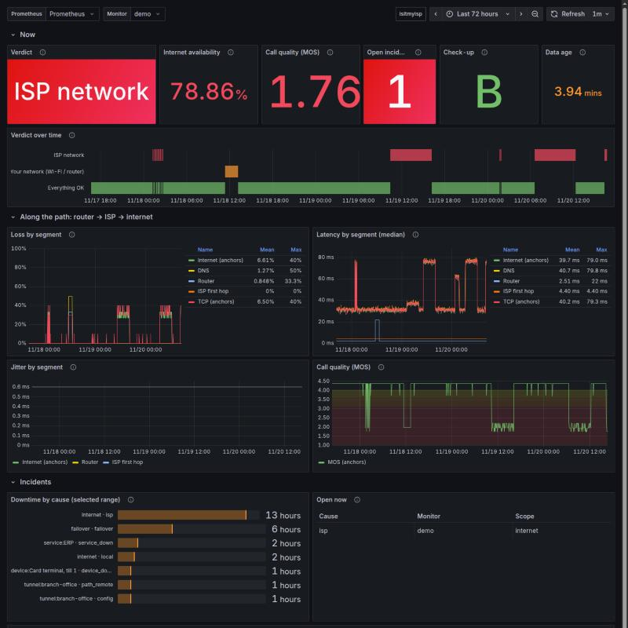

# Grafana dashboard for isitmyisp

isitmyisp has its own dashboard and doesn't need any of this. Use this one if you already run
Prometheus and Grafana and want the verdict next to the rest of your homelab: on the same screen as
your other boards, kept as long as your Prometheus keeps data, and in your own alerting.



## 1. Scrape `/metrics`

Copy the token from **Settings → Access** and add a job to `prometheus.yml`:

```yaml
scrape_configs:
  - job_name: isitmyisp
    scrape_interval: 30s          # the monitor measures in 30-second windows
    authorization:
      credentials: "<token from Settings → Access>"
    static_configs:
      - targets: ["192.168.1.10:8090"]   # where the web UI listens
```

## 2. Import the dashboard

In Grafana: **Dashboards → New → Import**, upload `isitmyisp.json` and pick your Prometheus.
With several monitors (home, office) the **Monitor** selector at the top switches between them.

## What's exported

| Metric | What |
|---|---|
| `isitmyisp_verdict{code}` | 1 for the verdict of the last window: `ok`, `local`, `access`, `isp`, `remote`, `dns`, `no_data`, `speedtest` (a test is running) |
| `isitmyisp_loss_ratio{role,target}` | Loss in the last window, 0–1, per destination: `home` (router), `isp` (first ISP hop), `anchor`, `tcp`, `dns`, `voip`, `service:<name>`, `device:<name>` |
| `isitmyisp_rtt_median_ms{role,target}` | Median latency |
| `isitmyisp_jitter_ms{role,target}` | Jitter |
| `isitmyisp_call_quality_mos{source}` | Estimated call quality (1–4.5) from the VoIP target, or from the anchors when there is none |
| `isitmyisp_incident_active{scope,code}` | 1 while an incident is open: `internet`, `service:<name>`, `device:<name>`, `tunnel:<name>`, `failover` (on the backup link), `public_ip` |
| `isitmyisp_incidents_total{scope,code}` | Incidents so far |
| `isitmyisp_incident_seconds_total{scope,code}` | Time spent in incidents so far; `increase()` over a range gives the downtime |
| `isitmyisp_route_changes_total` | Times the route to a watched destination changed |
| `isitmyisp_speedtest_download_mbps`, `_upload_mbps`, `_idle_latency_ms`, `_loaded_latency_ms`, `_timestamp_seconds` | The latest speed test (only once one has run) |
| `isitmyisp_link_mbps{direction}`, `isitmyisp_link_utilization_ratio{direction}`, `isitmyisp_router_cpu_ratio` | The router's internet link over SNMP (only with SNMP set up, and only while readings are fresh) |
| `isitmyisp_doctor_grade{grade}`, `isitmyisp_doctor_check{check,scope}`, `isitmyisp_doctor_timestamp_seconds` | The latest check-up: the grade, and each check as 0 ok, 1 to look at, 2 bad |
| `isitmyisp_last_window_timestamp_seconds` | When the last window was measured |
| `isitmyisp_build_info{version}` | The version |

Nothing that isn't set up is exported as a zero: until a speed test has run there are no speed test metrics.

## Alert rules (optional)

isitmyisp already sends its own alerts (Telegram, email, webhook). If you'd rather keep them in
Alertmanager:

```yaml
groups:
  - name: isitmyisp
    rules:
      - alert: InternetProblemAtTheISP
        expr: max by (instance) (isitmyisp_verdict{code=~"access|isp"}) == 1
        for: 5m
        annotations:
          summary: "The ISP is failing (verdict {{ $labels.code }})"
      - alert: IsitmyispStopped
        expr: time() - isitmyisp_last_window_timestamp_seconds > 300
        annotations:
          summary: "isitmyisp stopped measuring"
      - alert: CallsWouldSoundBad
        expr: avg_over_time(isitmyisp_call_quality_mos[10m]) < 3.6
        for: 10m
```
